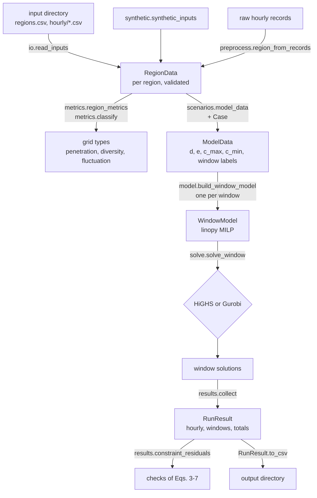

# Software architecture

## Data flow

`solve.run(region, case)` does the steps from `model_data` to `RunResult` in one call.

## Modules (`src/ghg_framework/`)

| Module | Content |
|---|---|
| `inputs.py` | `RegionData` (hourly demand, intensity, generation by fuel), `make_region`, format validation; the fuel sets `FUELS`, `RENEWABLE_FUELS`, `CURTAILABLE_FUELS`, `BASELOAD_FUELS` |
| `io.py` | read and write the input directory format |
| `preprocess.py` | steps of the data pipeline: period selection, gap filling, clipping, unit conversion, QA quantities, the column map of EIA's regional files |
| `scenarios.py` | `Case` (strategy settings and input changes), `model_data` (arrays of one run), `window_labels`, `scaled_intensity`, `feasibility_problems` |
| `model.py` | `ModelOptions`, `build_window_model`: variables, objective and constraints of [formulation.md](formulation.md), named by equation number |
| `solve.py` | `solve_window` (in memory, HiGHS by default or Gurobi), `solve_data` (all windows in time order), `run`; `SolveError` unless every window is optimal |
| `results.py` | `RunResult` (hourly, window and total tables; `to_csv`), `collect`, `constraint_residuals` |
| `metrics.py` | renewable share, diversity index (Eq. 8), intensity fluctuation statistics, `region_metrics`, `classify` |
| `synthetic.py` | the synthetic example regions and synthetic raw records |
| `cli.py` | the `ghg-framework` command: `synthetic`, `run`, `metrics` |

- A window model has one dimension, `t` (the hours of the window, numbered from 0).
- `WindowModel.hours` maps them back to positions in the run's arrays.
- `WindowModel.model` is a plain linopy model: constraints can be added before solving, for example ramping limits on $x_t$.

## Solvers

- **HiGHS** (default, open source, installed with `highspy`): branch and bound for the MILP of each window.
- **Gurobi** (optional): `pip install gurobipy` plus a licence, then `run(region, case, solver="gurobi")`.
- The default relative MIP gap is $10^{-6}$ for both. The objective is the change in emissions plus the penalty (formulation.md, conventions), so the gap applies to that change.
- Solver options go in a mapping and override the defaults, for example `run(region, case, options={"time_limit": 60})` for HiGHS or `run(region, case, solver="gurobi", options={"Threads": 4})`.

## Problem size

For a window of $T$ hours, the model has

- $T$ continuous variables $x_t$ and $T$ binary variables $z_t$;
- $4T + 1$ constraints: Eqs. (4)–(7) for every hour and Eq. (3) once.

A yearly window has 8,760 binaries. With $\lambda = 0$ the binaries do not enter the objective, and HiGHS solves a year in well under a second. With $\lambda > 0$ a window takes from a fraction of a second to a few seconds on a laptop. `examples/strategies.py` (about 60 runs of a synthetic year) takes about half a minute.

## Output tables

`RunResult.to_csv(directory)` writes:

| File | Rows | Columns |
|---|---|---|
| `hourly.csv` | hours | `time`, `window`, `demand_mwh`, `x`, `adjusted_demand_mwh`, `adjusted` (bool), `z`, `intensity_kg_per_mwh`, `baseline_emissions_t`, `emissions_t` |
| `windows.csv` | windows | `window`, `hours`, `baseline_t`, `optimized_t`, `reduction_t`, `reduction_pct`, `adjusted_hours`, `added_mwh`, `removed_mwh`, `objective_t`, `termination` |
| `totals.csv` | one | the case settings, then `hours`, `windows`, `baseline_t`, `optimized_t`, `reduction_t`, `reduction_pct`, `adjusted_hours`, `added_mwh`, `removed_mwh`, `reference_t`, `all_optimal` |

- `baseline_t`: the case's emissions without regulation ($x_t = 0$).
- `reduction_t = baseline_t − optimized_t`: the effect of load regulation.
- `reference_t`: emissions of the unchanged inputs without regulation; it differs from `baseline_t` only when the case scales demand, solar or wind.

## Tests (`tests/`, pytest)

- the data interface: validation errors (order, missing and non-finite values, signs, fuel columns, shapes), the input-directory round trip, refusal of columns with other units, duplicate regions;
- the model: window labels; optimal solves with Eqs. (3)–(7) recomputed from the solution; objective identity; non-negative reductions; larger windows and wider ranges never reduce less; λ lowers the adjusted hours; zero curtailment share means no regulation; the choice of $M$ does not change the optimum; infeasible hours are reported; case validation; the bounds and the intensity rule of `model_data`; user intensities and fuel sets;
- Gurobi and HiGHS agree on a small instance (skipped without gurobipy or a licence);
- metrics: Eq. (8) on known shares, renewable share, fluctuation statistics, classification;
- the pipeline: unit conversion, gap filling, recovery of a region from synthetic raw records, refusal of long gaps, period selection;
- the command line.
