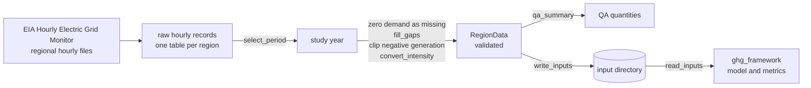

# Data pipeline and input schemas

This document has two parts:

- how the model inputs are built from public hourly data of U.S. grid regions;
- the file format the framework reads.

It describes structure only. **This repository contains no EIA data and none of the processed inputs used for the article.** The only data shipped are synthetic, made by `ghg_framework.synthetic`.

The module `ghg_framework.preprocess` implements the generic steps (period selection, gap filling, clipping, unit conversion, QA quantities). [`examples/prepare_inputs.py`](../examples/prepare_inputs.py) runs them end to end on synthetic raw records and writes an input directory.

## Overview

## Source

- **Data:** the U.S. Energy Information Administration's Hourly Electric Grid Monitor ([eia.gov/electricity/gridmonitor](https://www.eia.gov/electricity/gridmonitor/)), built on the EIA-930 survey of balancing authorities.
- **Regions:** EIA aggregates the balancing authorities of the contiguous United States into 13 regions: California (CAL), Carolinas (CAR), Central (CENT), Florida (FLA), Mid-Atlantic (MIDA), Midwest (MIDW), New England (NE), New York (NY), Northwest (NW), Southeast (SE), Southwest (SW), Tennessee (TEN) and Texas (TEX).
- **Files:** one workbook per region with a sheet of published hourly data. It holds demand, net generation by fuel, interchange, and EIA's estimates of CO2 emissions and emission intensity.
- **Fields used:**

| Field | Column in the regional file | Unit in the file | Used for |
|---|---|---|---|
| time | `Local time` (or `UTC time`) | – | hour index, windows |
| demand $d_t$ | `Consumed Electricity` (or `D`, demand) | MWh | Eqs. (2)–(5) |
| intensity $e_t$ | `CO2 Emissions Intensity for Generated Electricity` | lb CO2/kWh | Eqs. (1)–(2) |
| net generation by fuel | `NG: COL`, `NG: NG`, `NG: NUC`, `NG: OIL`, `NG: WAT`, `NG: SUN`, `NG: WND`, `NG: OTH` | MWh | $c^{max}_t$, $c^{min}_t$, Eq. (8), penetration |

`preprocess.EIA_COLUMNS` holds this mapping; pass `columns=` to `region_from_records` for another layout or another choice of field.

## Steps

### 1. Download and record

- Download the regional file of every region in the study.
- Record the access date and the SHA-256 checksum of each file. EIA revises its hourly data after first release, so the record identifies exactly which data were used.

### 2. Select the study period

- Read the hourly sheet and keep the study year (`select_period`, start inclusive, end exclusive).
- Use a time column without daylight-saving repeats: UTC, or local standard time. The framework requires strictly increasing timestamps without duplicates. Calendar windows (months, quarters) follow the column you choose.

### 3. Missing and implausible values (`region_from_records`)

- **Zero demand:** an hour with zero consumption is a reporting gap, not a real value. It is treated as missing (`zero_demand_as_missing=True`).
- **Short gaps:** runs of up to `max_gap` missing hours (default 3) in demand, intensity or any fuel are filled by linear interpolation between the neighbouring hours (`fill_gaps`).
- **Long gaps:** longer runs, and gaps at the start or end of the period, are not filled. `region_from_records` stops with an error that lists them. Decide case by case: a longer download window, another source for the period, or a different study period.
- **Negative net generation:** negative values (for example pumping or station use recorded as net consumption) are clipped to 0. The number of clipped values is in the report.
- Keep the report that `region_from_records` returns: it counts every filled, treated and clipped value per field.

### 4. Units

- Intensity is converted to kg CO2/MWh (`convert_intensity`; 1 lb/kWh = 453.59237 kg/MWh). Other units: `kg/MWh`, `g/kWh`, `t/MWh`, `lb/MWh`.
- Demand and generation stay in MWh per hour.

### 5. QA before use

`qa_summary(region)` returns the quantities to check:

- annual demand and generation (TWh), against EIA's published annual totals for the region;
- the ratio of generation to demand: above 1 for exporting regions, below 1 for importing ones;
- the share of solar, wind and hydro in generation;
- minimum, mean and maximum intensity, to catch unit errors (a factor of about 450 points to lb/kWh read as kg/MWh).

Also plot a week of each season, and look at the hours that were filled.

### 6. Write and re-read

`write_inputs(directory, regions)` writes the input directory, and `read_inputs(directory)` reads it back with all format checks.

## Input directory format

| File | Columns | Unit | Rules |
|---|---|---|---|
| `regions.csv` | `region`, `label` | – | unique region names; `label` is free text (may be empty) |
| `hourly/<region>.csv` | `time`, `demand_mwh`, `intensity_kg_per_mwh`, `gen_coal_mwh`, `gen_gas_mwh`, `gen_nuclear_mwh`, `gen_oil_mwh`, `gen_hydro_mwh`, `gen_solar_mwh`, `gen_wind_mwh`, `gen_other_mwh` | as in the column names | exactly these columns (units are part of the names; other columns are refused, not converted); `time` strictly increasing, no duplicates; all values finite; demand > 0; intensity ≥ 0; generation ≥ 0 |
| `README.txt` (optional) | free text | – | description of the dataset |

- One row per hour. The model does not require a full year, but the classification metrics and the article's design use one year per region.
- Each region file is checked when read; an error names the file.
- `ghg-framework synthetic my_inputs/` writes a complete synthetic directory in this format.

## Terms of use of the source

- EIA data are U.S. government data. EIA allows their use and redistribution, and asks for an acknowledgment of the source ("Source: U.S. Energy Information Administration"). See [eia.gov/about/copyrights_reuse.php](https://www.eia.gov/about/copyrights_reuse.php).
- Check the current terms before you redistribute data derived from the files.
